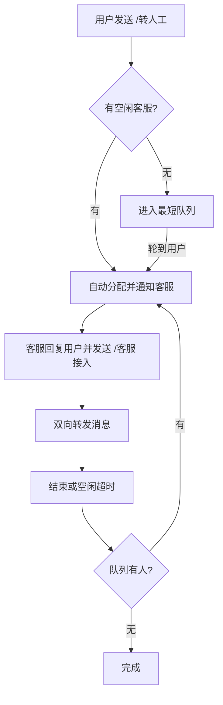

<div align="center">


# astrbot_plugin_human_service

_✨ 人工客服 ✨_  

[](https://www.gnu.org/licenses/agpl-3.0.html)
[](https://www.python.org/)
[](https://github.com/Soulter/AstrBot)

</div>


## 🎯 简介

`astrbot_plugin_human_service` 是一个功能强大的 AstrBot 人工客服插件，支持：

- ✅ **智能排队系统** - 客服忙碌时自动排队，避免同时服务多人
- ✅ **黑名单管理** - 拉黑骚扰用户，对所有客服生效
- ✅ **时间管理** - 对话空闲和排队超时自动处理
- ✅ **聊天记录** - 主动结束会话后自动向客服导出记录

---

## 📦 安装

在AstrBot插件市场搜索：astrbot_plugin_human_service，点击安装即可

---

## ⚙️ 配置说明

| 配置项 | 类型 | 默认值 | 说明 |
|:---:|:---:|:---:|:---|
| `servicers_id` | 列表 | [] | 客服QQ号列表，如：`["123456", "789012"]` |
| `blacklist` | 列表 | [] | 全局黑名单QQ号列表，客服命令的修改会自动保存 |
| `conversation_idle_timeout` | 整数(秒) | 300 | 连续无人参与多久后结束对话，0=不限制 |
| `queue_timeout` | 整数(秒) | 0 | 排队时间限制，0=不限制 |

---

## 📚 使用说明

### 用户命令

| 命令 | 说明 |
|:---:|:---|
| `转人工` | 请求转接人工客服 |
| `转人机` | 取消请求或结束对话 |

### 客服命令

| 命令 | 说明 |
|:---:|:---|
| `<引用用户消息> 客服 接入` | 接入用户对话 |
| `<引用用户消息> 客服 拒接` | 拒绝接入请求 |
| `客服 结束` | 结束当前对话 |
| `客服 拉黑 QQ号` | 拉黑指定用户 |
| `客服 取消拉黑 QQ号` | 取消拉黑用户 |
| `客服 黑名单` | 查看黑名单列表 |

---

## 🔄 使用流程



- 系统优先分配空闲客服；全部忙碌时进入排队人数最少的队列。
- 客服需要回复用户请求并发送 `/客服 接入`。
- 排队时再次发送 `/转人工` 可查看当前位置，发送 `/转人机` 可结束请求。
- 主动结束会话后自动向客服导出记录；空闲超时仅结束会话并处理下一位用户。

---

## 🎮 完整使用流程示例

### 典型对话流程

```
=== 用户A请求转人工 ===
用户A: /转人工
系统: 正在等待客服👤接入...

=== 客服接入 ===
客服小王: (回复用户A消息) /客服 接入
系统→用户A: 客服【小王】已接入
             ⏰ 连续 300 秒无人参与将自动结束
系统→客服: 好的，接下来我将转发你的消息给对方
            ⏰ 连续 300 秒无人参与将自动结束

=== 用户B也想转人工（客服忙碌） ===
用户B: /转人工
系统: 客服正在服务中🔴
      您已加入等待队列，当前排队人数：1
      您的位置：第 1 位
      
      💡 再次使用 /转人工 可查看当前位置

=== 正常对话 ===
用户A: 请问怎么使用这个功能？
客服小王: (收到) 请问怎么使用这个功能？

客服小王: 这个功能很简单...
用户A: (收到) 亲这个功能很简单...~  (前缀+后缀)

=== 对话空闲超时 ===
(用户和客服连续 300 秒未发送消息，插件收到下一条消息时检查)
系统→用户A: ⏰ 对话因长时间无人参与已自动结束。如需继续咨询，请重新转人工
系统→用户B: ⏰ 轮到您了！客服正在准备接入您的对话...
系统→客服: ⏰ 与用户 xxx 的对话因长时间无人参与已自动结束
            📋 队列中的下一位用户已准备就绪：
            用户：用户B(xxx)
            请使用 /客服 接入 命令开始服务
            （队列已清空）

=== 处理骚扰用户 ===
客服小王: /客服 拉黑 999888
系统: ✅ 已将用户 999888 加入黑名单（全局）

用户(999888): /转人工
系统: ⚠ 您已被加入黑名单，无法使用人工客服
```

---

## ❓ 常见问题

### Q1: 如何设置客服？
**A:** 在插件配置中设置 `servicers_id` 列表。如果不设置，默认使用全局管理员作为客服。

### Q2: 自动分配和排队如何工作？
**A:** 
- 有空闲客服时，系统自动分配空闲客服
- 所有客服都忙碌时，系统自动加入排队人数最少的客服队列
- 客服结束对话后，队列第一位自动准备接入

### Q3: 黑名单是否对所有客服生效？
**A:** 是。任一客服拉黑用户后，该用户将无法请求任何人工客服。

### Q4: 时间限制如何设置？
**A:** 
- `conversation_idle_timeout` 控制双方连续无人发送消息多久后结束对话
- 任一方成功发送消息后都会重新计算空闲时间
- 空闲超时会在插件收到下一条消息时检查
- `queue_timeout` 控制用户最长排队时间
- 设置为 `0` 表示不限制

---


## 🤝 贡献指南

- 🌟 **Star 这个项目**（点右上角星星）
- 🐛 **提交 Issue** 报告问题
- 💡 **提出建议** 新功能想法
- 🔧 **提交 PR** 改进代码


## 📌 注意事项

- 想第一时间得到反馈的可以来作者的插件反馈群（QQ群）：460973561（不点star不给进）
